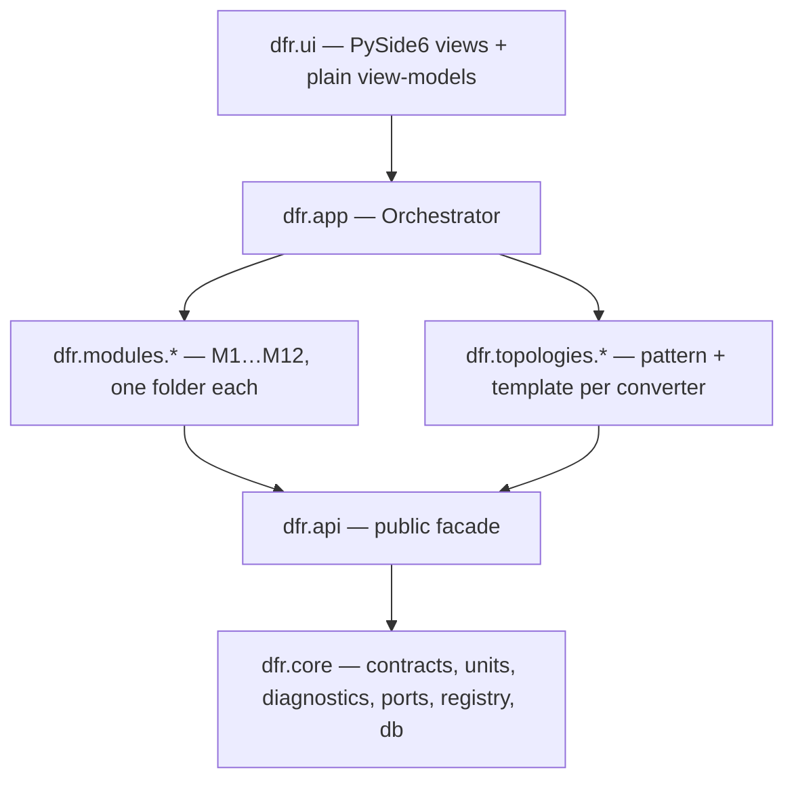

# Architecture

## Layers

Imports go down only (import-linter contract "Layers"). Modules are mutually independent
(contract "Modules are independent"), as are topologies.

## How a run works

1. `discover()` scans `dfr/modules/*/module.py`, `dfr/topologies/*/module.py`, entry points
   (`dfr.modules`, `dfr.plugins`) and `%APPDATA%/DfR/plugins/*.py`. Each yields a
   `ModuleSpec`. Wrong `api_version`, duplicate ids and import failures become diagnostics,
   never exceptions.
2. `build_pipeline(specs)` turns `requires`/`provides` into a DAG. A module whose requirement
   nobody provides is skipped with `PIPELINE_MISSING_DEP`; dependants drop transitively.
3. `Orchestrator.run_analysis()` creates an `analysis_run` row, snapshots the effective stress
   values (`pinned manual > Tier 2 newest > Tier 1 newest`), seeds a `RunContext` with
   `parts`, `effective_stress`, `run`, `config`, then calls each step in order. A step
   returns `StepResult(outputs, diagnostics)`; outputs are merged into the context under the
   capability names it declared. A crashing optional step is logged (`STEP_CRASHED`) and the
   run continues; a crashing required step fails the run.
4. All diagnostics are stored against the run; `finish()` freezes it. Any later write raises
   `ImmutableRunError`.

## Capability names (convention)

| Capability | Producer | Type |
| --- | --- | --- |
| `parts` | orchestrator | `list[Part]` (DNP excluded) |
| `effective_stress` | orchestrator | `dict[StressKey, StressValue]` |
| `role_map` | M12 | `RoleMap` |
| `stress` | M2 | `list[StressValue]` |
| `thermal` | M6 | `list[ThermalResult]` |
| `derating` | M5 | `list[DeratingResult]` |
| `lifetime` | M7 | `list[LifetimeResult]` |
| `failure_rate` | M8 | `FailureRateResult` |
| `refinement` | M3 | `list[RefinementItem]` |

New modules add rows here when they introduce a capability.

## Database

- One SQLite file per design (`.dfr`), `PRAGMA foreign_keys=ON`, WAL. All datetimes are
  aware UTC via `UtcDateTime`.
- Core owns the shared tables: `design, design_version, part, rating, net, pin, stage, rail,
  role_assignment, stress_value, value_prompt, analysis_run, effective_stress, diagnostic`.
- Each module owns its result tables (prefix = module id) through its own Alembic branch
  (`ModuleSpec.migrations_path`, branch label = module id). `migrate.upgrade_all()` applies
  core first, then every present module branch. If a module folder is deleted, its version row
  and tables stay in the file (reported as orphans, never fatal); re-installing resumes the branch.
- Repositories (`dfr/core/db/repos`) are the only code that touches ORM rows; everything
  above works with contracts.

## Extension points (`dfr.api`)

| Interface | Used by | Registered via |
| --- | --- | --- |
| `ModuleSpec` | every module | `MODULE` in `module.py` |
| `TopologyPattern` / `TopologyTemplate` | M12 / M2 | `TopologyRegistry` from a topology folder |
| `LifetimeModel` / `FailureRateModel` | M7 / M8 | model lists inside those modules |
| `ScreenSpec` | GUI stepper | `SCREENS` in `module.py` |
| `ReportSectionSpec` | M11 | `REPORT_SECTIONS` in `module.py` |
| `ChartSpec` | GUI + report | returned by modules in their results |

Every plugin result is stamped `tool = "<module_id>@<version>"` (`ModuleSpec.tool_tag`).

## Recipes

**Add a module** — copy `dfr/modules/_example`, rename the id, set `requires`/`provides`,
implement `run(ctx) -> StepResult`, write `migrations/0001_<id>.py` with
`branch_labels=("<id>",)` if you need tables, add `tests/<id>/`. Run the full check.

**Add a topology** — create `dfr/topologies/<id>/` with `pattern.py` (`TopologyPattern`),
`template.py` (`TopologyTemplate`, `pattern_id` = the pattern), `data/` and `module.py`
registering both. Add golden role-map and hand-calculated stress tests.

**Add a screen** — in the owning module's `module.py`, add a `ScreenSpec` to `SCREENS` with a
`factory` that builds the Qt view from a plain view-model. Only `dfr.ui.shell` and
`dfr.ui.kit` import PySide6.

## Tiered workflow state machine (PRD 2.6)

`DRAFT → CIRCUIT_CONFIRMED → T1_RUNNING → TRIAGED → T2_QUEUED → T2_AWAITING_INPUT → RERUN →
TRIAGED → … → FINAL` — represented by `SessionState`; the orchestrator's `parent_run_id`
chain is the persisted form of the loop.
