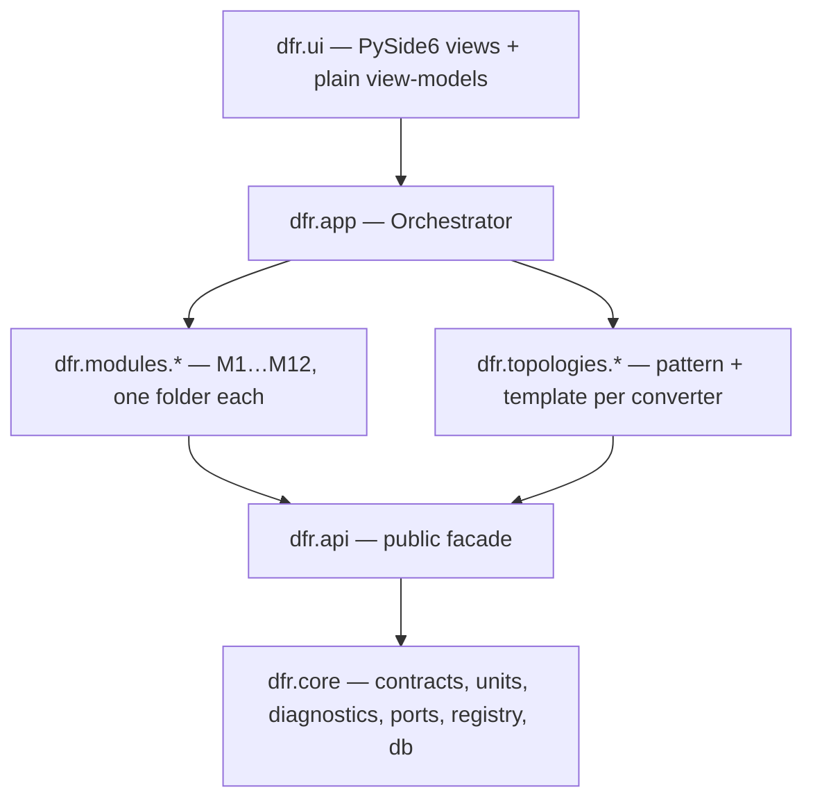

# Architecture

## Layers

Imports go down only (import-linter contract "Layers"). Modules are mutually independent
(contract "Modules are independent"), as are topologies.

## How a run works

1. `discover()` scans `dfr/modules/*/module.py`, `dfr/topologies/*/module.py`, entry points
   (`dfr.modules`, `dfr.plugins`) and `%APPDATA%/DfR/plugins/*.py`. Each yields a
   `ModuleSpec`. Wrong `api_version`, duplicate ids and import failures become diagnostics,
   never exceptions.
2. `build_pipeline(specs)` turns `requires`/`provides` into a DAG. A module whose requirement
   nobody provides is skipped with `PIPELINE_MISSING_DEP`; dependants drop transitively.
3. `Orchestrator.run_analysis()` creates an `analysis_run` row, snapshots the effective stress
   values (`pinned manual > Tier 2 newest > Tier 1 newest`), seeds a `RunContext` with
   `parts`, `effective_stress`, `run`, `config`, then calls each step in order. A step
   returns `StepResult(outputs, diagnostics)`; outputs are merged into the context under the
   capability names it declared. A crashing optional step is logged (`STEP_CRASHED`) and the
   run continues; a crashing required step fails the run.
4. All diagnostics are stored against the run; `finish()` freezes it. Any later write raises
   `ImmutableRunError`.

## Capability names (convention)

| Capability | Producer | Type |
| --- | --- | --- |
| `parts` | orchestrator | `list[Part]` (DNP excluded) |
| `effective_stress` | orchestrator | `dict[StressKey, StressValue]` |
| `role_map` | M12 | `RoleMap` |
| `stress` | M2 | `list[StressValue]` |
| `thermal` | M6 | `list[ThermalResult]` |
| `derating` | M5 | `list[DeratingResult]` |
| `lifetime` | M7 | `list[LifetimeResult]` |
| `failure_rate` | M8 | `list[FailureRateResult]` (one per table/method, never summed across methods) |
| `refinement` | M3 | `list[RefinementItem]` |
| `prompts`, `inferred_values`, `template_params` | M2 | `list[ValuePrompt]`, `InferredValues`, `dict` |
| `ruleset_hash` | M5 | `str` |

| `triage_context` | M3 (`run_context` service) | `dict` with `waivers`, `open_prompts` |
| `mission_profile` | app (`AnalysisInputs.profile`), echoed by M7 | `MissionProfile` |

Seeded by the app layer (`dfr.app.analysis.run_tier1`) before the run: `stage`, `role_map`,
`converter_spec`, `templates`, `ruleset`, optional `inferred_overrides`, `part_params`, plus
whatever every `run_context(session, design_version_id)` service returns (a module's way to
read its own stored per-version state, e.g. M3 waivers, without the orchestrator knowing it).
Steps may declare `optional_requires` for ordering without a hard dependency (M5 after M6,
M7 after M6, M3 after M5/M6/M7/M2).

New modules add rows here when they introduce a capability.

## Services (registry, not imports)

Modules expose named callables in `ModuleSpec.services`; the app and UI call
`registry.service(name)` (single provider) or `registry.services_named(name)` (fan-out, e.g.
every topology plugin's `topology.patterns`). Current names: `import_bom`, `import_netlist`,
`join_netlist`, `prune_dnp`, `resolve_pin_functions`, `save_pinout`, `persist_design` (M1);
`available_patterns`, `match_topology`, `apply_edits`, `confirm_roles`, `role_map_for`,
`check_staleness`, `prefill_from_stale` (M12); `infer_passives`, `compute_template_stress`,
`answer_prompt`, `manual_stress`, `import_t2_csv`, `parse_t2_csv` (M2); `load_ruleset`,
`load_derating_results` (M5); `solve_thermal`, `load_thermal_results` (M6);
`load_triage_config`, `load_refinement_items`, `load_triage_waivers`, `waive_refinement`,
`unwaive_refinement`, `run_context` (M3); `estimate_lifetimes`, `load_lifetime_constants`,
`load_lifetime_results` (M7); `compute_failure_rates`, `load_failure_rate_tables`,
`load_failure_rate_table_file`, `load_failure_rate_results` (M8); `build_report_html`,
`write_report_html`, `load_report_bundle` (M11); `topology.patterns`, `topology.templates`,
`topology.inference` (each topology folder). A module's own result rows are persisted by its
`persist` hook and read back only through its services, so M11 never imports M5/M6.

Report fan-out: a module contributes `report.bundle_extras(session, run_id) -> dict` (merged
into `RunBundle.extras` by M11's `load_bundle`) and `report.sections() -> [(ReportSectionSpec,
render)]`; `render(bundle)` formats numbers with `dfr.api.num` / `table` (shared helpers in
`dfr.core.report`, so no module imports M11). M3, M7 and M8 use this.

The spec and mission profile a run was made with are stored in the run row
(`RunConfig.with_inputs`, read back via `RunConfig.converter_spec` / `.mission_profile`).

## Database

- One SQLite file per design (`.dfr`), `PRAGMA foreign_keys=ON`, WAL. All datetimes are
  aware UTC via `UtcDateTime`.
- Core owns the shared tables: `design, design_version, part, rating, net, pin, stage, rail,
  role_assignment, stress_value, value_prompt, analysis_run, effective_stress, diagnostic`.
- Each module owns its result tables (prefix = module id) through its own Alembic branch
  (`ModuleSpec.migrations_path`, branch label = module id). `migrate.upgrade_all()` applies
  core first, then every present module branch. If a module folder is deleted, its version row
  and tables stay in the file (reported as orphans, never fatal); re-installing resumes the branch.
- Repositories (`dfr/core/db/repos`) are the only code that touches ORM rows; everything
  above works with contracts.

## Extension points (`dfr.api`)

| Interface | Used by | Registered via |
| --- | --- | --- |
| `ModuleSpec` | every module | `MODULE` in `module.py` |
| `TopologyPattern` / `TopologyTemplate` | M12 / M2 | `TopologyRegistry` from a topology folder |
| `LifetimeModel` / `FailureRateModel` | M7 / M8 | model lists inside those modules |
| `ScreenSpec` | GUI stepper | `SCREENS` in `module.py` |
| `ReportSectionSpec` | M11 | `report.sections` service (+ `report.bundle_extras` for rows) |
| `ChartSpec` | GUI + report | returned by modules in their results |

Every plugin result is stamped `tool = "<module_id>@<version>"` (`ModuleSpec.tool_tag`).

## Recipes

**Add a module** — copy `dfr/modules/_example`, rename the id, set `requires`/`provides`,
implement `run(ctx) -> StepResult`, write `migrations/0001_<id>.py` with
`branch_labels=("<id>",)` if you need tables, add `tests/<id>/`. Run the full check.

**Add a topology** — create `dfr/topologies/<id>/` with `pattern.py` (`TopologyPattern`),
`template.py` (`TopologyTemplate`, `pattern_id` = the pattern), `data/` and `module.py`
registering both. Add golden role-map and hand-calculated stress tests.

**Add a screen** — create `dfr/ui/screens/<id>/screen.py` exposing `SCREEN = ScreenSpec(id, title,
step, order, requires=(module ids,))` and `build(vm) -> QWidget`. The Project panel and document
tabs are built from this folder scan; a screen whose required modules are absent is hidden.
Shared state lives in `dfr.ui.viewmodels.workspace.Workspace` (Qt-free) and engine calls go
through registry services. Colors only from `dfr/ui/tokens.py`; selection goes to the
Properties panel via `vm.select(Selection(...))`.

## Tiered workflow state machine (PRD 2.6)

`DRAFT → CIRCUIT_CONFIRMED → T1_RUNNING → TRIAGED → T2_QUEUED → T2_AWAITING_INPUT → RERUN →
TRIAGED → … → FINAL` — represented by `SessionState`; the orchestrator's `parent_run_id`
chain is the persisted form of the loop.
